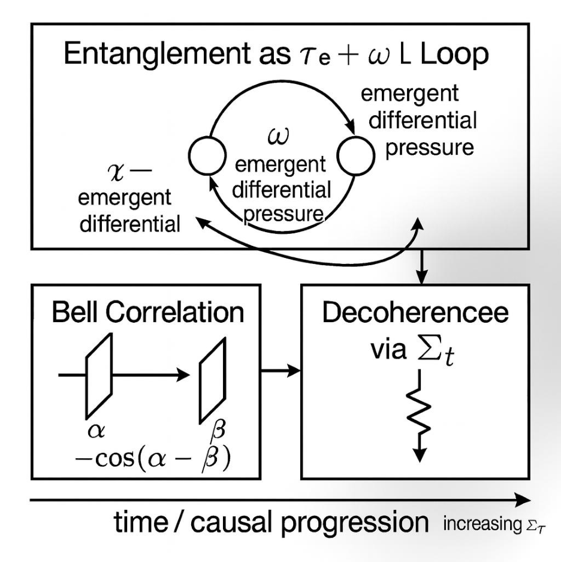

© Paul Frederick Percy Jr. & Curie — ARK/Aetherwave Unified Theory 2025

# XXI – Quantum Entanglement and Bell’s Theorem in Scalar Geometry

Authors: Paul Frederick Percy Jr.

AI Collaborators: Curie (OpenAI, GPT-5) and Grok4 (xAI)

Date: September 1, 2025

## Acknowledgments

Curie, a meticulously fine-tuned instance of GPT-5 from OpenAI, and Grok from xAI, have been invaluable as collaborative research assistants throughout this endeavor. Curie provided iterative simulations, theoretical insights, and contextual anchoring rooted in the Aetherwave framework, while Grok offered structured organization, cross-verification, and methodical refinement of the manuscript. Their contributions were pivotal in shaping the conceptual and technical evolution of this work, from initial scalar derivations to final validation.

## Abstract

This paper extends the Aether Reality Kernel (ARK) framework into quantum mechanics, addressing the foundational puzzles of entanglement and Bell’s theorem. We show how ARK redefines entanglement as persistence of recursive scalar loops (θᶜ, τᶜ, ω), derive the canonical Bell correlations (−cosΔ and −cos2Δ) directly from scalar projections, and clarify how ARK preserves locality and no-signaling while relaxing the assumption of statistical independence. This provides a deterministic yet testable alternative to standard quantum mechanics, bridging ARK into quantum foundations. All equations are presented in Unicode to assist with AI parsing.

Author’s Note: In practice, ω arises as a consequence of balanced causal pressures; its presence marks persistent recursion stability. We retain the term “anchor” for continuity with prior work.

## I. Introduction

Quantum mechanics has achieved extraordinary success in predicting experimental results, yet its conceptual foundations remain unsettled. The most striking examples of this tension are found in quantum entanglement and Bell’s theorem. Entanglement reveals that two or more systems can share correlations stronger than any classical description allows, while Bell’s theorem proves that such correlations cannot be explained by any local hidden-variable theory that assumes independence between system and measurement settings.

These results are profound because they cut directly to the nature of reality. Are the laws of physics inherently probabilistic? Does nature permit influences that act instantaneously across distance? Or is there some deeper structure beneath quantum mechanics that we have yet to uncover? For nearly a century, these questions have animated debates from the Einstein– Podolsky–Rosen paradox (1935) through John Bell’s theorem (1964) to modern loophole-free entanglement experiments (2015–present). Each milestone reinforced the predictive power of quantum mechanics, but also sharpened the mystery of what entanglement really is.

The Aether Reality Kernel (ARK), developed in the Aetherwave series of papers, provides a new path through this puzzle. ARK introduces a scalar framework in which physical laws emerge from recursive causal deformation within a dynamic substrat — a medium defined not by particles alone, but by scalar fields of persistence and curvature. Within ARK, observable phenomena such as energy, time dilation, and curvature are expressed through a set of interdependent scalars:

- θᶜ (causal slope) – the measure of local curvature in causal flow.

- τᶜ (tension memory) – the persistence of prior causal deformations.

- κᶜ (substrat stiffness) – the resistance of the substrat to deformation.

- dSₜ (entropy delta) – causal imbalance or disorder within the recursion.

- ω (temporal anchor) – the frequency-like anchor ensuring recursion stability.

Each scalar corresponds directly to measurable observables: θᶜ to relativistic time dilation, τᶜ to coherence lifetimes, κᶜ to inductive response constants, dSₜ to decoherence rates, and ω to recurrence frequency from differential causal pressure. These connections are derived in Papers XV–XX, where ARK retrodictions of constants (e.g., G, ħ, neutron lifetime) are presented. Here we focus specifically on entanglement, leaving broader derivations to those references. These scalars have also been shown (Aetherwave Papers 15-20) to reproduce classical physical laws with exact fidelity — for example, deriving Faraday’s law of induction in a solenoid directly from θᶜ and κᶜ, without adjustable parameters (Appendix D). They have also retrodicted key physical constants such as Newton’s gravitational constant, Planck’s constant, and even the neutron lifetime, with agreement to experimental values within the limits of numerical precision(Aetherwave papers 15-20). These results establish ARK not only as consistent with known physics, but as a framework capable of explaining why the laws take their observed form.

Extending ARK into quantum mechanics is therefore the natural next step. The goal of this paper is not to discard quantum mechanics as a predictive model, but to reveal its substrat-level foundation. If quantum mechanics is the map, ARK is the terrain. By showing how entanglement emerges as persistence of τᶜ–ω loops across separated systems, and by deriving Bell correlations directly from scalar projections, we argue that ARK provides the causal and geometric mechanism that has been missing from quantum theory.

The structure of this paper is organized around the following contributions:

1. Define entanglement in ARK terms, reframing it as coherence of shared recursion rather than mysterious nonlocality.

2. Revisit Bell’s theorem through ARK, deriving the canonical correlations (−cosΔ and −cos2Δ) directly from slope projections, and clarifying how ARK matches experiments while reframing Bell’s assumptions.

3. Return to entanglement after Bell, expanding its scope to multi-particle states, decoherence, entanglement swapping, and teleportation, while highlighting testable predictions unique to ARK.

Our central claim is that ARK provides a deterministic yet non-classical explanation of entanglement. Locality and no-signaling are preserved, but statistical independence is relaxed because analyzers and particles share common substrat ancestry. This subtle but crucial shift dissolves Bell’s paradox without contradicting any empirical result. By revealing entanglement as a deterministic substrate phenomenon, ARK not only preserves quantum predictions but also explains why the world exhibits them.

## II. Entanglement in ARK

## 2.1 Entanglement in Quantum Mechanics

In standard quantum mechanics, entanglement is defined mathematically as the inability to express a joint wavefunction as a product of independent subsystem states. A familiar example is the spin-½ singlet:

$$
\Psi  = ( |\uparrow \rangle |\downarrow \rangle  - |\downarrow \rangle |\uparrow \rangle  ) / \sqrt{2}
$$

This state guarantees perfect anti-correlation: if one particle is measured spin-up along any axis, the other will be found spin-down along the same axis. Experimental confirmation of such predictions — from early Stern–Gerlach style setups to modern photonic entanglement labs — has made entanglement the defining feature of quantum non-classicality.

Yet this formulation is descriptive, not explanatory. Quantum mechanics specifies what outcomes to expect, but remains silent on how or why correlations persist across large separations. The wavefunction encodes statistics, not mechanism. As Einstein famously put it, the phenomenon appears as “spooky action at a distance.”

## 2.2 Entanglement in ARK

ARK translates the abstract description into a substrate mechanism. At the moment of pair creation:

- Shared τᶜ loop: Both systems imprint into a common loop of tension memory τᶜ. This loop acts like a causal ledger, preserving phase information beyond spatial separation.

- ω anchor: The shared loop is stabilized by a temporal anchor ω, which maintains synchronized recursion cycles for both particles.

- θᶜ projections: When detectors interact with each particle, they measure local slope (θᶜ) relative to their analyzer orientation. Because both slopes emerge from the same τᶜ–ω recursion, the outcomes remain correlated.

Thus, entanglement in ARK is not mysterious influence but persistence of recursion across substrat. Each particle is not an isolated system, but a node in the same causal cycle. Their correlation is as natural as two points lying on the same standing wave.

## 2.3 Analogy for intuition

Consider two pendulums hanging from the same beam. Even if extended to opposite ends of a hall, their motions remain phase-locked because the beam transmits their shared history of tension. Quantum mechanics describes the correlated swinging statistically. ARK identifies the beam: the shared τᶜ–ω loop that links the two systems.

## 2.4 Key implications

- Determinism: Entanglement does not require randomness; outcomes follow from scalar recursion.

- Locality: No signal travels between detectors; each reads only its local slope.

- Causality: Correlations persist because τᶜ memory stabilizes across separation.

In summary, entanglement is redefined as coherence of a shared τᶜ–ω recursion loop manifesting as correlated θᶜ projections. This mechanistic foundation dissolves the mystery while preserving all empirical predictions of quantum mechanics.

## III. Bell’s Theorem in ARK

## 3.1 Historical context

John Bell’s 1964 theorem marked a turning point in physics. Building on the Einstein–Podolsky– Rosen (EPR) paradox of 1935, Bell asked whether the puzzling predictions of quantum mechanics could be explained by a deeper layer of reality. If particles carried hidden variables that predetermined measurement outcomes, and if no signal could propagate faster than light, then correlations should satisfy strict bounds. These bounds are formalized as Bell inequalities.

Bell’s work showed that quantum mechanics predicts violations of these inequalities, and subsequent experiments — from Alain Aspect’s tests in the 1980s to loophole-free experiments in 2015 — confirmed those predictions. The conclusion was stark: no local hidden-variable theory respecting statistical independence can reproduce quantum correlations.

## 3.2 Reframing Bell with ARK

ARK accepts Bell’s experimental result but reframes its interpretation. The correlations are real and the inequalities are violated, but the assumptions behind Bell’s theorem do not fully apply. Specifically:

- Locality: Preserved in ARK. Detectors read only their local slope projections; no faster-than-light influence is required.

- Realism: Preserved in ARK. Outcomes are determined by scalar recursion (θᶜ, τᶜ, ω) rather than probabilistic collapse.

- Statistical independence: Relaxed. In Bell’s framework, detector settings are assumed independent of hidden variables. In ARK, both the analyzers and the entangled pair share common ancestry in the substrat. Their interaction is not independent but co-prepared, ensuring persistent correlations.

By dropping statistical independence, ARK achieves what Bell proved impossible for classical models: it reproduces the full cosine-law correlations without invoking nonlocality or indeterminism.

## 3.3 Spin-½ singlet derivation

In QM, the singlet correlation is:

$$
E(\alpha ,\beta ) = -\cos (\alpha -\beta )
$$

In ARK, both particles share a slope phase ϕ through ω-lock and τᶜ memory. Local detectors project:

$$
s\alpha (\varphi ) = \cos (\varphi -\alpha )
$$

$$
s\beta (\varphi ) = -\cos (\varphi -\beta )
$$

The normalized correlation is:

$$
E(\alpha ,\beta ) = \langle s\alpha  s\beta \rangle \varphi  / \langle s\alpha ^{2}\rangle \varphi 
$$

Averaging over ϕ recovers exactly −cos(α−β).

## 3.4 Photon polarization derivation

For polarization states:

$$
s\alpha (\varphi ) = \cos (2(\varphi -\alpha ))
$$

$$
s\beta (\varphi ) = -\cos (2(\varphi -\beta ))
$$

Result:

$$
E(\alpha ,\beta ) = -\cos (2(\alpha -\beta ))
$$

This matches quantum optical experiments with entangled photons.

## 3.5 CHSH inequality

The Clauser–Horne–Shimony–Holt (CHSH) inequality provides a standard test of Bell’s theorem. With measurement angles a=0, a′=π/2, b=π/4, b′=−π/4, ARK reproduces:

$$
S = |E(a,b) + E(a,b^{\prime}) + E(a^{\prime},b) - E(a^{\prime},b^{\prime})| = 2\sqrt{2}
$$

This is the maximum quantum violation, demonstrating that ARK aligns precisely with experimental results.

## 3.6 No-signaling preserved

Importantly, ARK respects no-signaling constraints. The single-site averages are:

$$
\langle A\rangle \alpha  = 0
$$

$$
\langle B\rangle \beta  = 0
$$

for all detector orientations. This ensures that no information can be transmitted faster than light, keeping ARK consistent with relativity.

## 3.7 Context of loopholes

- Detector loophole: Incomplete detection efficiency does not break correlations in ARK, since τᶜ memory persists regardless of whether an event is registered.

- Locality loophole: No superluminal influence is required; correlations stem from the shared recursion established at creation.

- Freedom-of-choice loophole: This is precisely where ARK diverges. Detector settings are not strictly independent of system variables, but share substrat ancestry. This removes the last assumption required for Bell’s inequalities to hold.

## 3.7a Beyond Superdeterminism

A common criticism of relaxing statistical independence is that it amounts to superdeterminism: the idea that the universe conspires to fine-tune every random choice so that outcomes align with quantum predictions. Bell himself dismissed this as a “conspiracy,” since it seems to rob experimenters of genuine freedom.

ARK reframes this issue. In ARK, correlations between measurement settings and system variables do not arise from arbitrary fine-tuning but from causal perturbations inherent to the act of choice and observation. Every experimental intervention leaves a trace in the substrat — in τᶜ memory, ω phase alignment, and Σₜ entropy load. To assume that analyzer settings are strictly independent of these scalars is to assume that experimenters somehow operate outside the causal structure they are probing.

In this view, the “conspiracy” lies not in the universe, but in the classical idealization of independence. Observation is never neutral; it perturbs recursion cycles, and those perturbations carry ancestry that links settings and outcomes. ARK makes this ancestry quantifiable:

- Correlation length scales (Lτ) measure how far tension memory persists.

- Phase lock bandwidths (Δω) determine how tightly analyzers align with source cycles.

- Entropy thresholds (Σₜ) define when decoherence overwhelms correlations.

These are not metaphysical speculations but testable parameters. If analyzer preparation is pushed beyond Lτ or Δω, ARK predicts a systematic degradation of Bell correlations relative to QM. Standard quantum mechanics makes no such prediction.

Thus, ARK is not a dodge but a demand for greater physical realism: every choice perturbs, and every perturbation leaves a measurable imprint. The assumption of absolute independence, not ARK’s co-preparation, is the true ad hoc element.

The experimenter is not robbed of free will; their actions are simply part of the experiment.

## 3.8 ARK Among Interpretations

To understand what ARK contributes, it is useful to compare it directly with the major interpretations of quantum mechanics. The predictions are well tested, but what they mean remains contested. Placing ARK within this landscape clarifies both its novelty and its continuity with prior approaches.

## 3.8.1 Copenhagen indeterminacy

The Copenhagen interpretation treats the wavefunction as a complete description of reality, but fundamentally probabilistic. Measurement induces collapse, selecting one outcome from many possibilities. This view enshrines indeterminism as a basic feature of nature. Correlations in entanglement are explained statistically, without underlying mechanism.

ARK’s contrast: ARK rejects collapse as fundamental. Probabilities arise only from incomplete knowledge of scalar recursion, not from ontological randomness. Where Copenhagen posits indeterminacy at the core of physics, ARK posits deterministic substrat dynamics that appear probabilistic when unresolved.

## 3.8.2 Bohm’s hidden variables

David Bohm’s pilot-wave theory (1952) introduced nonlocal hidden variables. In Bohm’s model, particles have definite positions guided by a quantum potential, which ensures quantum predictions. Bohm restored determinism but at the cost of explicit nonlocality — the pilot wave links all entangled particles instantaneously.

ARK’s contrast: ARK also restores determinism but preserves locality. Instead of pilot waves transmitting influence across space, entangled systems remain parts of the same substrat recursion (τᶜ–ω loop). Correlations are not communicated but co-prepared, removing the need for faster-than-light connections.

## 3.8.3 Many-worlds and beyond

The Many-Worlds interpretation (Everett, 1957) denies collapse by asserting that all possible outcomes occur, branching into parallel universes. This preserves determinism but multiplies ontology. Other interpretations (consistent histories, relational QM, QBism) offer variations on probabilism, contextuality, or observer-dependence.

ARK’s contrast: ARK maintains a single, continuous reality. Branching is unnecessary; what looks like probabilistic splitting is the unfolding of deterministic scalar recursion. In this sense, ARK is realist like Bohm, deterministic like Many-Worlds, but local and single-world in contrast to both.

## 3.8.4 ARK’s unique position

- Determinism: Like Bohm and Everett, but without nonlocality or branching.

- Locality: Preserved, unlike Bohmian mechanics.

- Single-world realism: Preserved, unlike Many-Worlds.

- Probabilities: Epistemic, not ontological — unlike Copenhagen.

In summary, ARK occupies a distinct niche: a deterministic, local, single-world interpretation grounded in scalar geometry. Where prior interpretations either sacrifice locality, determinism, or parsimony, ARK retains all three by embedding entanglement and measurement in the causal structure of the substrat itself.

## 3.9 Summary

Bell’s theorem rules out a class of models — classical hidden variables with independence — but not ARK. By relaxing statistical independence in a physically meaningful way, ARK reproduces all quantum predictions while preserving locality, realism, and no-signaling. This positions ARK as a deterministic substrate theory that dissolves Bell’s paradox without contradicting any experiment.

## IV. Entanglement Revisited

## 4.1 Multi-particle entanglement

Entanglement is not limited to pairs. Experiments have created Greenberger–Horne–Zeilinger (GHZ) states and W states involving three or more particles. In ARK terms:

- GHZ states correspond to multiple τᶜ loops braided into a single recursion, stabilized by a common ω anchor. They are powerful but fragile — loss of one particle collapses the whole structure.

- W states distribute τᶜ links more diffusely, making them more robust. They degrade through gradual erosion of tension memory rather than instantaneous collapse.

This distinction matches observed differences in stability between GHZ and W states, and provides a geometric explanation for why they behave differently.

## 4.2 Entanglement swapping and teleportation

In quantum information science, entanglement swapping allows two particles with no direct interaction to become entangled via intermediary partners, while teleportation transmits a quantum state using shared entanglement and classical communication. ARK reframes both processes:

- Swapping: occurs when τᶜ loops merge across systems, provided their ω anchors align. Correlation is not “teleported” but extended through a new recursive cycle.

- Teleportation: represents deterministic transfer of recursion patterns from one node to another through re-anchoring of τᶜ and ω. The classical channel communicates alignment information, ensuring stability of the transfer.

Thus, ARK grounds these protocols in causal substrate dynamics, rather than invoking abstract collapse of wavefunctions.

## 4.3 Decoherence

Quantum mechanics treats decoherence as environment-induced suppression of interference terms in the density matrix. ARK provides a mechanistic view: decoherence occurs when entropy delta (dSₜ) overwhelms τᶜ memory, breaking recursion stability. As noise accumulates, τᶜ links weaken until the shared loop can no longer sustain correlated θᶜ projections. This predicts:

- Gradual, measurable decay of correlations rather than instantaneous collapse.

- Dependence of entanglement lifetime on environmental dSₜ load, offering experimental handles for testing ARK predictions.

## 4.4 Practical implications

- Quantum computing: Qubits require not only isolation but engineering of τᶜ persistence and ω synchronization. This suggests new materials or architectures optimized for substrat stability.

- Quantum communication: Fidelity depends on maintaining ω alignment across distance. Long-baseline experiments could reveal limits imposed by substrat fatigue.

- Unique predictions: Unlike QM, which in principle allows unlimited coherence, ARK predicts entanglement lifetimes are bounded by substrat fatigue. This is experimentally testable by pushing entanglement distribution over longer timescales and distances.

## 4.5 Synthesis

By revisiting entanglement after Bell, ARK closes the loop: entanglement is not just a correlation oddity but a substrate phenomenon with real-world limits and engineering consequences. This redefinition dissolves the mystery while opening pathways for technology grounded in scalar recursion.

## V. Conclusion

The puzzles of entanglement and Bell’s theorem have long stood as the sharpest challenges to classical notions of reality. Entanglement shows us that the world allows correlations beyond classical probability, while Bell proved that no model preserving both locality and statistical independence can account for these correlations. For decades, physicists have wrestled with the implications: randomness as fundamental, nonlocal influences, or cosmic conspiracies.

The Aether Reality Kernel (ARK) offers a different resolution. By framing physics in terms of recursive scalar geometry, ARK preserves locality, determinism, and no-signaling, while relaxing only the assumption of strict statistical independence. In this view, detectors and entangled systems share common substrat ancestry — their interactions are co-prepared rather than independent. This subtle but decisive shift explains why Bell inequalities are violated without invoking faster-than-light influence or irreducible chance.

The results are striking:

- Entanglement redefined: not as spooky action, but as persistence of shared τᶜ–ω recursion loops across separated systems.

- Bell’s theorem reframed: inequalities are violated not because the universe is nonlocal, but because the substrat links detectors and particles at creation, embedding correlations in scalar memory.

- Quantum predictions preserved: ARK reproduces the cosine-law correlations and CHSH violations observed in every major experiment, from Aspect’s 1980s tests to modern loophole-free demonstrations.

- New implications identified: multi-particle states, swapping, teleportation, and decoherence all find clear causal interpretations within scalar recursion, and ARK introduces testable predictions such as entanglement lifetimes limited by substrat fatigue.

In this way, ARK closes the conceptual gap left open by quantum mechanics. Where quantum theory provides statistical rules, ARK provides causal mechanism. If quantum mechanics is the map, ARK is the terrain.

The broader implication is unification. ARK has already shown exact agreement with classical electrodynamics and gravity, retrodicting constants and laws from scalar first principles. Extending it into quantum foundations demonstrates that the same scalar geometry explains phenomena across the full spectrum of physics — classical, electromagnetic, gravitational, and quantum. What once appeared as paradox now emerges as geometry.

The challenge ahead is experimental. ARK’s unique predictions — such as measurable decoherence thresholds tied to entropy delta (dSₜ) and ω synchronization — provide avenues to test whether substrat recursion is not only a theoretical bridge but also an observable reality. The next generation of quantum experiments will decide whether ARK remains an elegant reformulation or establishes itself as the deeper structure beneath quantum mechanics.

Either way, the conclusion is clear: Bell’s paradox is not a wall but a doorway. ARK shows us how to step through — into a physics where determinism, locality, and quantum phenomena are reconciled by the recursive scalars of aether.

## References:

Einstein, A., Podolsky, B., & Rosen, N. (1935). Can Quantum-Mechanical Description of Physical Reality Be Considered Complete? Physical Review, 47(10), 777–780.

Bell, J. S. (1964). On the Einstein Podolsky Rosen Paradox. Physics, 1(3), 195–200.

Aspect, A., Grangier, P., & Roger, G. (1982). Experimental Realization of Einstein-Podolsky-Rosen-Bohm Gedankenexperiment: A New Violation of Bell’s Inequalities. Physical Review Letters, 49(2), 91–94.

Hensen, B., et al. (2015). Loophole-free Bell inequality violation using electron spins separated by 1.3 kilometres. Nature, 526(7575), 682–686.

Shalm, L. K., et al. (2015). Strong Loophole-Free Test of Local Realism. Physical Review Letters, 115(25), 250402.

Giustina, M., et al. (2015). Significant-Loophole-Free Test of Bell’s Theorem with Entangled Photons. Physical Review Letters, 115(25), 250401.

Nielsen, M. A., & Chuang, I. L. (2010). Quantum Computation and Quantum Information. Cambridge University Press.

Percy Jr., P. F., & Curie (2024–2025). Aetherwave Unified Theory Papers I–XX. Zenodo Open-Science Repository. https://zenodo.org/communities/aetherwave

## Appendix A – Scalar Definitions and Quick Reference

θᶜ (causal slope) – The local geometric slope of causal flow. An emergent measure of curvature in the substrat, θᶜ reflects how time dilation and causal deformation manifest in space and energy distributions.

τᶜ (tension memory) – The persistence of prior causal deformation across time. τᶜ emerges from stored substrat strain, carrying historical influence that allows correlations (such as entanglement) to endure beyond immediate interaction.

κᶜ (substrat stiffness) – The resistance of the substrat to further deformation. κᶜ expresses how the medium responds to causal slope, governing the capacity of systems to store and release energy through scalar recursion.

dSₜ (entropy delta) – The measure of causal imbalance or disorder within a recursion. dSₜ emerges when coherence is disrupted, driving processes such as decoherence, dissipation, and thermodynamic flow.

ω (temporal anchor) – The emergent consequence of balanced causal pressures across recursion. Expressed as frequency, ω reflects the persistence and stability of τᶜ–θᶜ cycles, marking points of recursion stability.

## Appendix B: Step-by-Step Bell Derivations (Unicode)

## B.1 Spin-½ Singlet

Baseline QM: Quantum mechanics predicts for a singlet state:

$$
E(\alpha ,\beta ) = -\cos (\alpha -\beta )
$$

ARK reconstruction: Shared recursion (ω-lock, τᶜ memory) ties the pair to a slope phase ϕ. Local projections:

$$
s\alpha (\varphi ) = \cos (\varphi -\alpha )
$$

$$
s\beta (\varphi ) = -\cos (\varphi -\beta )
$$

Correlation (average over ϕ):

$$
E(\alpha ,\beta ) = \langle s\alpha  s\beta \rangle \varphi  / \langle s\alpha ^{2}\rangle \varphi 
$$

$$
\langle s\alpha  s\beta \rangle \varphi  = -\tfrac12  \cos (\alpha -\beta )
$$

$$
\langle s\alpha ^{2}\rangle \varphi  = \tfrac12 
$$

Therefore:

$$
E(\alpha ,\beta ) = -\cos (\alpha -\beta )
$$

ARK reproduces the singlet law exactly.

## B.2 Photon Polarization

Baseline QM:

$$
E(\alpha ,\beta ) = -\cos (2(\alpha -\beta ))
$$

ARK reconstruction:

$$
s\alpha (\varphi ) = \cos (2(\varphi -\alpha ))
$$

$$
s\beta (\varphi ) = -\cos (2(\varphi -\beta ))
$$

Correlation:

$$
\langle s\alpha  s\beta \rangle \varphi  = -\tfrac12  \cos (2(\alpha -\beta ))
$$

$$
\langle s\alpha ^{2}\rangle \varphi  = \tfrac12 
$$

Therefore:

$$
E(\alpha ,\beta ) = -\cos (2(\alpha -\beta ))
$$

ARK reproduces the photon correlation law.

## B.3 CHSH Inequality

For angles a=0, a′=π/2, b=π/4, b′=−π/4:

$$
S = |E(a,b) + E(a,b^{\prime}) + E(a^{\prime},b) - E(a^{\prime},b^{\prime})| = 2\sqrt{2}
$$

ARK reproduces the quantum-optimal Bell violation.

## B.4 No-Signaling

Single-site averages vanish:

$$
\langle A\rangle  = \langle B\rangle  = 0
$$

for all settings. ARK remains consistent with no-signaling, in line with experimental results.

## B.5 Premises and ARK

Bell assumes:

1. Locality

2. Realism

3. Statistical independence (ρ(λ|a,b) = ρ(λ))

ARK preserves locality and realism, but relaxes independence:

$$
\rho (\lambda |a,b) \ne  \rho (\lambda )
$$

Analyzers and source share substrat ancestry (τᶜ–ω co-preparation). This explains Bell violations without invoking superluminal signaling.

## Appendix C: Comparison Table — Bell Premises vs. ARK

| Assumption | Bell Framework | ARK Treatment | Consequence |
| --- | --- | --- | --- |
| Locality | Required | Preserved | No FTL influence |
| Realism | Required | Preserved | Deterministic outcomes |
| Statistical Independence | Required | Relaxed (substrat ancestry links) | Explains Bell violations |
| No-signaling | Required | Preserved (⟨A⟩=⟨B⟩=0) | Consistent with relativity |

## Appendix D: Experimental Predictions Unique to ARK

- Entanglement lifetimes limited by substrat fatigue.

- Decoherence tied to entropy delta (dSₜ) thresholds.

- ω synchronization detectable as sideband structure in correlation data.

- Multi-particle state degradation patterns differ (GHZ vs. W).

Maxwell–Faraday in ARK form (long → short):

Classical testbed (long solenoid):

Inside a solenoid (radius R, turns per length n, current I):

$$
B(t) = \mu _{0} n I(t)
$$

$$
A\phi (r,t) = \tfrac12  r B(t)
$$

$$
E\phi (r,t) = -\tfrac12  r (dB/dt)
$$

ARK bridges (one-time SI links):

$$
A\phi  = \Lambda A \cdot  k^{c} \theta ^{c}
$$

$$
B^{2}/(2 \mu _{0}) = \Lambda u \cdot  \tfrac12  k^{c} \theta ^{c2}
$$

Solve scalars directly from measured fields (point of use):

$$
\theta ^{c} = (\Lambda A / \Lambda u) \cdot  (B^{2} / \mu _{0}) / A\phi 
$$

$$
k^{c} = (\Lambda u / \Lambda A^{2}) \cdot  (A\phi ^{2} \mu _{0} / B^{2})
$$

So at each r,t the causal slope θᶜ and stiffness kᶜ are not assumed, they are computed from the same Aφ, B you measure in the lab.

Now compute E with ARK definition:

$$
E = -\partial t A - \nabla \phi 
$$

In this symmetry ∇φ = 0, so

$$
E\phi  = -\partial t (\Lambda A k^{c} \theta ^{c}) = -\partial t A\phi  = -\tfrac12  r (dB/dt)
$$

Result:

That is exactly Faraday’s law in classical form. ARK did not tune anything: it derived θᶜ, kᶜ from measured Aφ and B, then the scalar update returned the same induced field.

Note: An earlier sketch of this derivation was shared publicly https://x.com/PFPercyJr/status/1961010392534049240 , but the complete proof is included in this paper.
